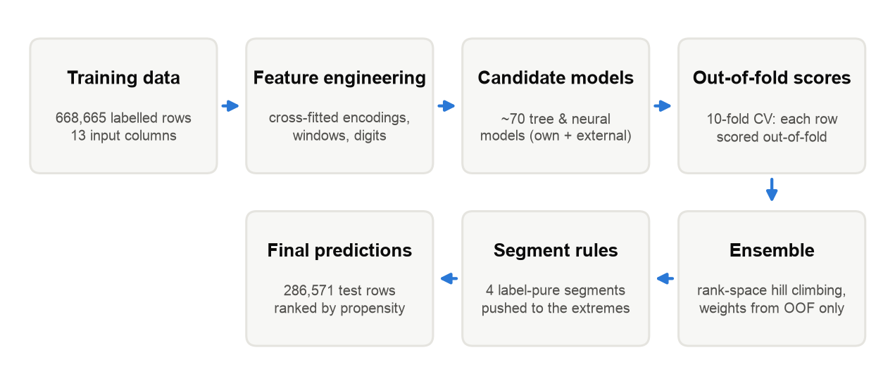

# Data-Driven Targeting of Likely Electric Vehicle Buyers

**An Ensemble Approach with Gradient-Boosted and Neural Network Models**

   A purchase-propensity model that ranks people by how likely they are to buy an electric vehicle,
so that incentives and marketing can be focused on the most likely buyers. Trained on 668,665
labelled records with 13 demographic, mobility, charging-access and attitude features, and
benchmarked in an open machine-learning competition with ~3,300 teams, where it finished
**307th (top 10%)**.

📄 **Full technical report:** [report/EV_Purchase_Prediction_Technical_Report.pdf](report/EV_Purchase_Prediction_Technical_Report.pdf):
methodology, every experiment accepted or rejected, results and limitations.

## Results

| | ROC AUC |
|---|---|
| Baseline single notebook (final hidden test set) | 0.94509 |
| **Final ensemble (final hidden test set)** | **0.94546** |
| Final ensemble (10-fold cross-validation) | 0.94650 |
| Ensemble of my own models only (10-fold cross-validation) | 0.94621 |
| Best single model I trained (10-fold cross-validation) | 0.94612 |

Cross-validation tracked the hidden test set closely. Alternatives tuned to the public leaderboard
scored higher on the public split but lower on the final evaluation.

## How it works



1. **Leakage-safe features.** Cross-fitted target encodings at several smoothing strengths and
   resolutions, window encodings (purchase rate among people with similar income or commute),
   interaction encodings, digit and frequency features.
2. **Candidate models.** Gradient-boosted trees (LightGBM, XGBoost, CatBoost) and neural networks
   (MLP with periodic embeddings, RealMLP, TabM), all on the same 10 stratified folds.
3. **Out-of-fold predictions** for every training row drive every decision: feature selection,
   model selection and ensemble weights. The public leaderboard was never used to choose anything.
4. **Rank-space hill-climbing ensemble** (Caruana selection with replacement). It beat logistic,
   non-negative and LightGBM stacking in honest half/half held-out comparisons.
5. **Segment rules.** Four segments with a constant label across all training rows are pushed to
   the top or bottom of the ranking; accepted only after improving all 5 validation folds.

See sections 3–6 of the report for what was tried and rejected (reference-data features,
nearest-neighbour labels, pseudo-labelling, TabM, residual target encoding, level-2 stackers, …).

## Repository structure

| File | Purpose |
|---|---|
| `quick_checks.py` | Fast 5-fold LightGBM screening of feature ideas against a fixed baseline |
| `exp_orig.py` | Screening of reference-dataset features (frequency, target rates, nearest neighbours) |
| `view_model.py` | 10-fold LightGBM / XGBoost / CatBoost on configurable feature views |
| `mlp_model.py` | 10-fold PyTorch MLP with optional periodic embeddings |
| `pool.py` | Loads, aligns and rank-normalises all OOF / test prediction pairs |
| `blend.py` | Hill-climbing and logistic stacking with honest half-split estimates |
| `stack_l2.py`, `blend_nn.py` | Level-2 LightGBM and non-negative logistic stackers (evaluated, rejected) |
| `resid_te.py` | Residual target encoding on top of the ensemble (evaluated, rejected) |
| `rules.py`, `finish_blend.py` | Segment rules and final prediction file |
| `notebooks/baseline_notebook.ipynb` | The single-notebook baseline the project started from |
| `report/` | Technical report (PDF), its figures and the script that builds it |

## Getting started

```bash
python -m venv .venv && source .venv/bin/activate
pip install -r requirements.txt
```

Download the data as described in [data/README.md](data/README.md), then:

```bash
# 1. screen feature ideas (minutes)
python quick_checks.py

# 2. train 10-fold models; each writes oof/<name>_oof.npy and oof/<name>_test.npy
python view_model.py E_win --win                                    # LightGBM + window encodings
python view_model.py F_pairs --win --pairs                          # + interaction encodings
python view_model.py G_shallow --win --pairs --depth 2 --leaves 4 --lr 0.05 --colsample 0.5 --mcs 200
python mlp_model.py M_pairs_emb --win --pairs --emb --seeds 42,7,2026

# 3. ensemble and apply the segment rules
mkdir -p submissions
python blend.py --save submissions/blend_hc.csv
python finish_blend.py submissions/blend_hc.csv blend

# 4. rebuild the report
python report/build_report.py
```

Run the training scripts one at a time: each uses all CPU cores (or the GPU, for the MLP).

### External predictions (optional)

The final ensemble also weighed ~60 out-of-fold prediction sets published by other competition
participants. They are not redistributed here. `pool.py` picks them up automatically if placed in
the folders it lists, and skips any that are missing, so the pipeline runs on your own models alone
(OOF 0.94621 with the four models above).

## Credits

External out-of-fold predictions and published model code by competition participants
(usernames): megayak, najiama, lucifer19, heuljax, blamerx, medvax, yekenot, chinzorigtganbat,
mizushimatoshihiko, tamerlanomralinov, legtarrr, dariushafshar, marcmaldonado, aryankaisth,
evgendvorkin, kirill0212, udaken10 and stephentarter; exploratory analysis of the reference data by
Chris Deotte. The segment rules were found by the community and independently verified here.

## License

[MIT](LICENSE) for the code in this repository. The data is not included and remains subject to
its original terms.
